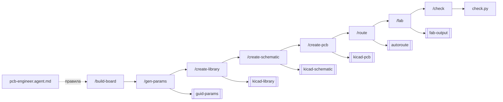

# Архітектура агента pcb-engineer

## Яку задачу вирішує агент
Технічне завдання лабораторної роботи № 2 алгоритмічне: параметри плати
повністю визначаються GUID, отриманим з ПІБ студента. Агент перетворює це ТЗ
на відтворюваний конвеєр у KiCad: кожен етап — окремий скрипт, який агент пише
за специфікацією skill, і перевірка, яку виконує сам KiCad (ERC, DRC з
порівнянням схеми й плати). Ручна робота в GUI не потрібна; GUI використовується
лише для перегляду і скріншотів.

## Компоненти

| Рівень | Файл | Роль |
|---|---|---|
| Manifest | `.github/agents/pcb-engineer.agent.md` | роль, ТЗ, межі, правила, заборони, критерії завершення |
| Skill | `guid-params` | ПІБ → GUID → компоненти, піни, мережі, вільні піни |
| Skill | `kicad-library` | символи й футпринти U1–U5, J1 |
| Skill | `kicad-schematic` | проєкт KiCad, схема на мітках мереж, ERC |
| Skill | `kicad-pcb` | контур 85.6 × 53.98 мм, правила, мережі, розміщення за зв'язками |
| Skill | `autoroute` | Freerouting через Specctra DSN/SES |
| Skill | `fab-output` | ERC/DRC, Gerber RS-274X, Excellon, зображення, CI |
| Command | `gen-params`, `create-library`, `create-schematic`, `create-pcb`, `route`, `fab` | по одній на skill |
| Command | `check` | лише перевірка |
| Orchestrator | `build-board` | 7 кроків по черзі, зупинка на першій помилці |
| Tool | `.github/agent-tools/check.py` | детермінована перевірка, 10 груп, exit code 0/1 |

## Дані між етапами
| Етап | Вихід → вхід наступного |
|---|---|
| gen-params | `params/board.json`: GUID, U1–U5 (розмір, піни-символи), мережі `N_*`, `FREE_*`, J1 |
| create-library | `hardware/lib/lab2.pretty`, `lab2.kicad_sym` — імена футпринтів `Ux_NxNmm` |
| create-schematic | `lab2.kicad_sch` з детермінованими UUID символів |
| create-pcb | `lab2.kicad_pcb`: футпринти з шляхами до тих самих UUID символів, мережі `/N_*` |
| route | доріжки на F.Cu/B.Cu |
| fab | `output/`: звіти, Gerber, зображення |

Детерміновані UUID (`uuid5` від імені об'єкта) поєднують схему і плату: DRC з
`--schematic-parity` перевіряє, що на платі ті самі компоненти й мережі, що на схемі.

## Обробка помилок
- Кожна команда має «Перевірки»; оркестратор зупиняється на першому `FAIL`.
- Перевірки виконує KiCad (`kicad-cli … --exit-code-violations`) і `check.py`, а не модель.
- Заборонено послаблювати правила DRC, вимикати перевірки, збільшувати плату.
- Розведену плату `/create-pcb` і `/route` не перезаписують (`SKIP`).

## Інструменти і відповідність методичці
| Методичка | Реалізація |
|---|---|
| САПР EasyEDA / Altium / KiCad | KiCad 10.0 (нативно на Linux, `kicad-cli` + модуль `pcbnew`) |
| онлайн-генератор GUID або код | `uuid5(NAMESPACE_DNS, ПІБ)` у `tools/params.py` |
| створити символи й футпринти | генерація S-виразів KiCad, перевірка `FootprintLoad` |
| з'єднати однакові піни | мітки мереж на схемі |
| вільні піни на край з меншої сторони | роз'єм J1 біля лівої короткої сторони плати й лівого краю схеми |
| трасування, мінімальна довжина, без гострих кутів | розміщення за HPWL + Freerouting (0/45/90°) |
| DRC | `kicad-cli pcb drc --schematic-parity` |
| Gerber RS-274X | `kicad-cli pcb export gerbers --no-x2` + Excellon |

Агентські файли згенеровано за допомогою Claude Code; формат сумісний з GitHub Copilot.
